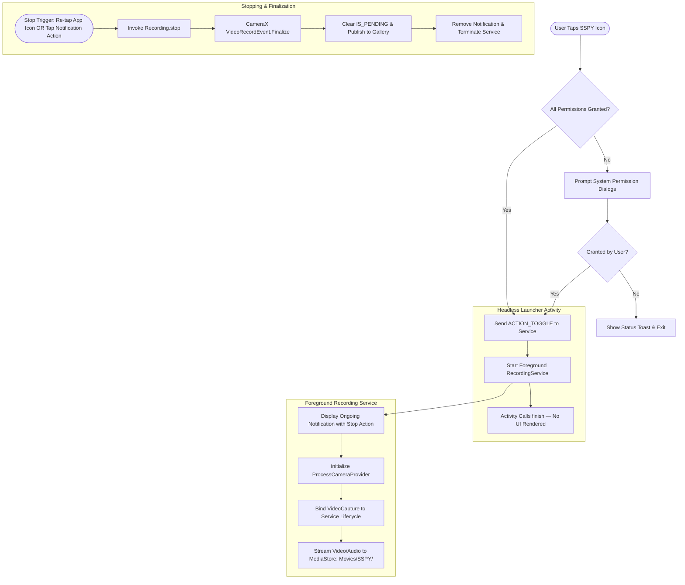

<p align="center">
  
</p>

<h1 align="center">SSPY</h1>

<p align="center">
  <b>⚠️ For Educational Purpose Only</b>
</p>

<p align="center">
  
</p>

<p align="center">
  <a href="release/app-release.apk">
    
  </a>
  <a href="https://github.com/Kmrr-Gautam/SPYY/releases">
    
  </a>
  <a href="https://github.com/Kmrr-Gautam/SPYY">
    
  </a>
  <a href="https://github.com/Kmrr-Gautam/SPYY">
    
  </a>
  <a href="https://github.com/Kmrr-Gautam/SPYY">
    
  </a>
</p>

---

> [!CAUTION]
> ## ⚠️ FOR EDUCATIONAL PURPOSE ONLY
> **This project is strictly developed and published for educational, academic, and research purposes only.**
>
> - **Informed Consent**: This application must **never** be used for covert, unauthorized, or non-consensual surveillance or recording. Always obtain explicit permission from everyone present before recording video or audio.
> - **Legal Compliance**: You are solely responsible for adhering to all local, national, and international laws regarding digital privacy, wiretapping, and video/audio recording.
> - **Platform Safety**: This demo operates strictly within standard Android framework APIs. It does not tamper with or bypass Android's system camera/microphone indicators (green dot) or notification controls.

---

## 🔍 How This App Works

SSPY demonstrates how an Android application can perform background video and audio recording using **Android Jetpack CameraX** and a **Foreground Service** without binding a visible camera preview on screen.

Here is the exact step-by-step process of how the application functions:

### 1. App Launch & Headless Controller (No UI)
- When you tap the **SSPY** launcher icon, [`MainActivity`](file:///c:/Users/Gautam%20Kumar/Downloads/SSPY/app/src/main/java/com/example/sspy/activities/MainActivity.java) launches invisibly using a transparent window theme (`@android:color/transparent` with no content layout).
- There is **no UI screen or button** shown on display.
- The activity checks if the required permissions have been granted:
  - `CAMERA` (Camera hardware access)
  - `RECORD_AUDIO` (Microphone audio recording)
  - `POST_NOTIFICATIONS` (Android 13+ foreground status notifications)

### 2. Runtime Permissions
- **First Launch**: If permissions are missing, standard Android system dialogs appear asking the user to grant access.
- If the user denies any permission, the app displays a short explanatory message and closes.
- If all permissions are granted, the app automatically transitions to the recording step.

### 3. Starting the Recording Service
- [`MainActivity`](file:///c:/Users/Gautam%20Kumar/Downloads/SSPY/app/src/main/java/com/example/sspy/activities/MainActivity.java) sends an `ACTION_TOGGLE` intent to [`RecordingService`](file:///c:/Users/Gautam%20Kumar/Downloads/SSPY/app/src/main/java/com/example/sspy/services/RecordingService.java) using `ContextCompat.startForegroundService()`.
- Once the service signals that initialization has succeeded, [`MainActivity`](file:///c:/Users/Gautam%20Kumar/Downloads/SSPY/app/src/main/java/com/example/sspy/activities/MainActivity.java) immediately calls `finish()`. The user remains on their home screen or current app.

### 4. CameraX Lifecycle Binding (Without Camera Preview)
- [`RecordingService`](file:///c:/Users/Gautam%20Kumar/Downloads/SSPY/app/src/main/java/com/example/sspy/services/RecordingService.java) binds CameraX `VideoCapture<Recorder>` directly to its own **Service Lifecycle** rather than an Activity.
- Normally, camera apps bind both a `Preview` use case and a `VideoCapture` usecase to an Activity. SSPY intentionally binds **only** `VideoCapture` to the rear camera.
- A brief Android system Toast ("Recording started") is shown.

### 5. Persistent Notification & User Safety
- In compliance with modern Android requirements (Android 10 through Android 15 / API 35), the app displays a persistent, low-priority ongoing foreground notification in the notification shade:
  - **Title**: `SSPY is recording`
  - **Text**: `Rear camera and microphone recording is active.`
  - **Action**: Includes an explicit **Stop Recording** button.
- Android's native status bar privacy indicator (green camera/mic icon) remains active so the user is always informed of hardware use.

### 6. Stopping & Saving Video
The user can stop recording in either of two ways:
1. **Tap the notification**: Tap the **Stop Recording** button in the notification shade.
2. **Tap the launcher icon**: Tapping the SSPY app icon again sends another `ACTION_TOGGLE` intent, which automatically commands the active recording to stop.

### 7. File Storage & Gallery Publishing
- Video is recorded in standard **H.264/AAC MP4** format using Android's Scoped Storage `MediaStore` API.
- Output path: Public collection under **`Movies/SSPY/`**.
- During recording, the file is tagged with `IS_PENDING = 1` so that partial/incomplete files do not appear in video galleries.
- Upon successful finalization:
  - CameraX finalizes the MP4 file.
  - The service verifies the file integrity and clears the pending flag.
  - The video is immediately available in the device's Gallery / Photos app.
  - A brief confirmation message ("Recording stopped. Video saved to Gallery.") is displayed.

---

## 📊 Visual Workflow Diagram



---

## 🛠️ Components & Architecture

| Component | Responsibility |
| :--- | :--- |
| **[`MainActivity`](file:///c:/Users/Gautam%20Kumar/Downloads/SSPY/app/src/main/java/com/example/sspy/activities/MainActivity.java)** | Transparent, headless launcher activity that triggers start/stop toggles without displaying an in-app UI. |
| **[`RecordingService`](file:///c:/Users/Gautam%20Kumar/Downloads/SSPY/app/src/main/java/com/example/sspy/services/RecordingService.java)** | Foreground service managing CameraX, audio capture, state tracking, and lifecycle teardown. |
| **[`RecordingNotificationManager`](file:///c:/Users/Gautam%20Kumar/Downloads/SSPY/app/src/main/java/com/example/sspy/notifications/RecordingNotificationManager.java)** | Builds and updates the persistent notification with the explicit stop action. |
| **[`VideoStorageManager`](file:///c:/Users/Gautam%20Kumar/Downloads/SSPY/app/src/main/java/com/example/sspy/storage/VideoStorageManager.java)** | Prepares pending MediaStore entries under `Movies/SSPY/`, validates sizes, and commits final videos. |
| **[`PermissionManager`](file:///c:/Users/Gautam%20Kumar/Downloads/SSPY/app/src/main/java/com/example/sspy/permissions/PermissionManager.java)** | Encapsulates Android runtime permission checks for camera, microphone, and notifications. |
| **[`RecordingState`](file:///c:/Users/Gautam%20Kumar/Downloads/SSPY/app/src/main/java/com/example/sspy/models/RecordingState.java)** | State machine enforcing valid state transitions (`IDLE` ➔ `STARTING` ➔ `RECORDING` ➔ `STOPPING` ➔ `FINALIZING` ➔ `SAVED`). |

---

## 🏗️ Build & Setup Instructions

### Environment Requirements
- **Android SDK**: Compile / Target SDK 35, Minimum SDK 29 (Android 10)
- **Java**: JDK 17+ (for Gradle execution; project source compatibility is Java 11)
- **Gradle**: 8.9 (via wrapper)

### Command-Line Build (PowerShell)

```powershell
# Run the state-machine unit tests
.\gradlew.bat testDebugUnitTest

# Assemble the release APK
.\gradlew.bat assembleRelease

# Or assemble the debug APK
.\gradlew.bat assembleDebug
```

The APK files will be output to:
- **Release APK**: `app/build/outputs/apk/release/app-release.apk`
- **Debug APK**: `app/build/outputs/apk/debug/app-debug.apk`

### Install onto an Emulator or Physical Device

```powershell
adb install -r app/build/outputs/apk/release/app-release.apk
```

---

## ⚖️ Legal & Educational Disclaimer

> [!IMPORTANT]
> **For Educational Purpose Only.**
> This software is intended exclusively for technical study, security research, and understanding modern Android background service limitations. The authors and contributors bear no liability for any misuse of this project. Always respect personal privacy and comply with applicable laws.
